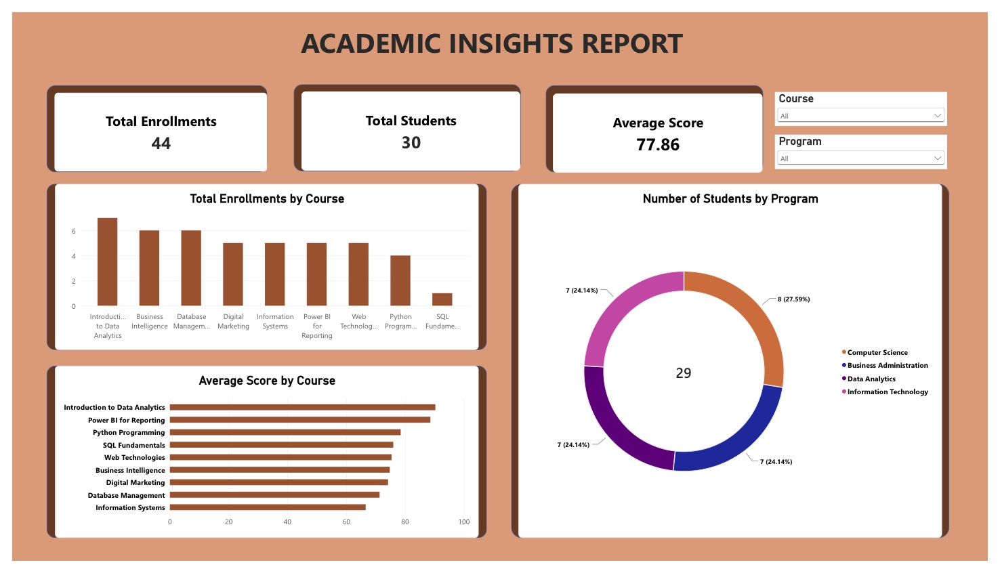
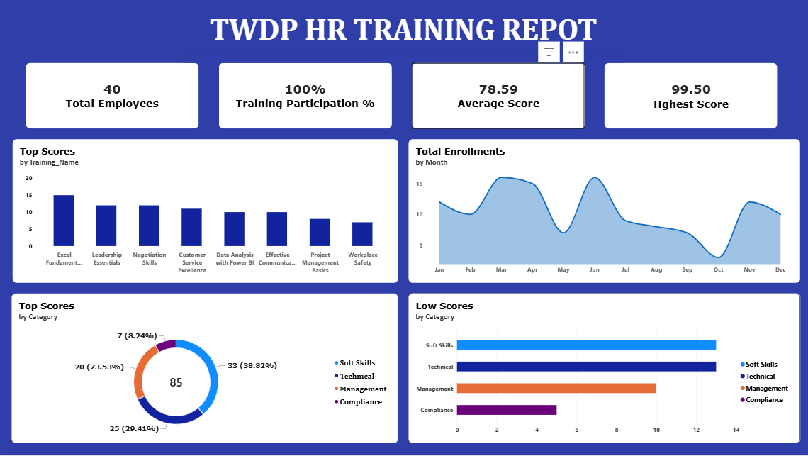

# Power BI Reports: Academic Insights and HR Training

Two reports I built in Power BI, each answering a different set of questions from a small dataset.

## Report 1: Academic Insights Report

Looks at how students are doing across courses and programs.

**What it shows**
- Total enrollments, total students and the overall average score
- Enrollments for each course
- Average score for each course
- Number of students in each program (Computer Science, Business Administration, Data Analytics, Information Technology)
- Dropdown filters for course and program

## Report 2: TWDP HR Training Report

Tracks how employees took part in company training and how they scored.

**What it shows**
- Total employees, training participation, average score and highest score
- Top scores for each training course
- Enrollments by month
- Top scores and low scores broken down by category (Soft Skills, Technical, Management, Compliance)

## How I built them

- Loaded and cleaned the data in Power Query
- Wrote DAX measures for the totals and averages
- Chose visuals that fit each question: bar charts for comparing, donut charts for shares, an area chart for the trend over time
- Added slicers so the reports can be filtered

## Files

- `[your first .pbix file name].pbix`: Academic Insights Report
- `[your second .pbix file name].pbix`: TWDP HR Training Report
- `IMG_3552.jpeg` and `Screenshot_2026-10-12_012643.png`: screenshots of the reports

## Notes

The data in these reports is [sample data provided during training / describe your source].

## Author

Gideon Adebayo
[LinkedIn link]
